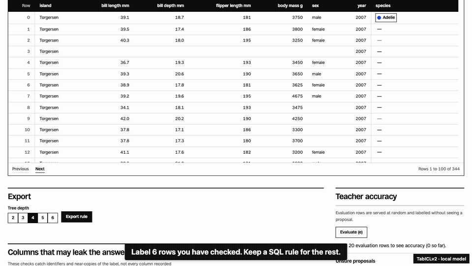

# Rowsetta

You know the label when you see the row.

Show Rowsetta a few examples. Take away a SQL rule you can read, review and run without the model.

<picture>
  <source media="(prefers-reduced-motion: reduce)" srcset="docs/hero.png">
  
</picture>

Check the suggestions against rows held aside and labelled blind. The export also reports how often the rule agrees with the model; that agreement is not a measure of whether the labels are right.

Your data stays on your machine. No account or model token required.

**[See the demo](https://rowsetta.intesarjawad.com/)**, or install it below to work on your CSV.

## Install and try

In a source checkout, with Python 3.13, uv 0.13.7, Node 26 and pnpm 12.16.1 installed:

```sh
make setup && uv run rowsetta demo
```

That starts the bundled penguins demo. The first run downloads the pinned model weights. Choose `species` to inspect existing labels, or clear them and label rows yourself. For your own file, run `uv run rowsetta open data.csv`.

The browser demo runs **TabICLv2 on Chromium with WebGPU**, and a labelled lite random forest on other browsers. Build it with `make browser`.

## How it works

1. **Label a handful of rows.** A tabular model, the teacher, reads them and suggests labels for the rest, marking the rows it is unsure about.
2. **Check it blind.** Rowsetta holds some rows back and asks you to label them without showing its guess, so the accuracy it reports is measured, not assumed.
3. **Audit the labels.** It ranks the labels the teacher doubts, yours included, and shows each one on a map of the rule. A suggestion is not proof that a label is wrong.
4. **Export the rule.** The teacher's behaviour is distilled into one decision tree, written as SQL, dbt, Python or JSON, with a certificate of how often the exported rule agrees with the teacher.

The rule you export is plain code you can read, review and run anywhere. The model stays behind.

## Evidence and limits

- **The picture is staged.** It uses the Palmer penguins table with labels deliberately changed by `scripts/mislabel_demo.py`, so the audit has something to find.
- **Accuracy is for your sample.** Teacher accuracy counts raw predictions on every evaluation row, including rows marked unsure. It does not guarantee performance on future data.
- **The benchmarks are smoke runs.** [Benchmark measurements](docs/bench.md) name their scripts and settings. They are not the full preregistered evidence for whether the teacher beats direct decision trees, so do not infer a general advantage from them.
- **Classification on CSV files only.** Tables above `10,000` rows are sampled, files default to a `200 MB` limit, and up to `100` columns are accepted ([limits in code](src/rowsetta/core/table.py)).
- **Leak checks are partial.** They find some identifiers and near-copies of the target, not every post-outcome column. Text columns whose values are mostly distinct are skipped.

## Develop

`make check` runs the local checks. `make dev` serves the frontend at <http://127.0.0.1:5173> against a local server started with `uv run rowsetta demo --no-browser --port 8787`. More in the [development notes](docs/development.md), [architecture](docs/architecture.md) and [contributing](CONTRIBUTING.md).

## Licence

Code is licensed under [Apache-2.0](LICENSE). Third-party licences and attributions are in [NOTICE](NOTICE). The bundled datasets and their licences are listed in [datasets/CARDS.md](datasets/CARDS.md). Model weights are not bundled.
