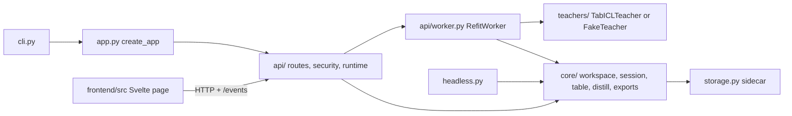

# Architecture

A pure Python core holds every rule about tables, labels, the teacher, the
distilled tree and its exports. A thin shell around it (the CLI, a FastAPI
server and session storage) owns files, the network, threads and the clock. A
Svelte page talks to the server over HTTP and server-sent events.

## Module map

### `src/rowsetta/core/`

No module here reads files, opens sockets or starts threads; the shell passes
bytes, teachers, random generators and persistence in.

| Module | Responsibility |
| --- | --- |
| `table.py` | `load_csv` parses CSV bytes into a `Table`, samples files above the row cap with seed 7 and infers each column's kind. |
| `errors.py` | `UserError` and its subclasses, each with `what` and `next_step`. |
| `session.py` | `LabelStore`: classes, human labels, the blind evaluation sample, undo history and threshold, serialized as the session file (`docs/session.schema.json`). |
| `features.py` | `teacher_frame` drops the target, excluded columns and text columns inferred as free text with more than half of values distinct. |
| `teacher.py` | The `Teacher` protocol, `predict_table` (fit on human labels, predict the rest in batches) and `proposals_from_proba` (abstain below the threshold). |
| `active.py` | `next_row`, the active-learning choice of the next row to label. |
| `evaluation.py` | Accuracy, balanced accuracy and per-class recall on the served evaluation rows. |
| `leaks.py` | `find_leaks`: identifiers, single-column predictors and suspicious names. |
| `audit.py` | `audit_labels`: out-of-fold ranking of existing human labels. |
| `distill.py` | The student tree: `fit_student`, fidelity in sample and cross-fitted, the direct-tree baselines, the exact McNemar comparison, `split_condition` and `leaf_summary`. |
| `export/sql.py` | `tree_to_sql` for any scikit-learn tree ([library guide](library.md)), `to_sql` and the certificate. |
| `export/dbt.py`, `export/python.py`, `export/json.py` | The other export formats (`docs/export.schema.json` for JSON). |
| `workspace.py` | `Workspace`: the loaded table, the store and the latest proposals, with a generation number that rises on every edit. |
| `prereg.py` | The frozen teacher-value rule of [ADR 0006](adr/0006-teacher-values.md). |

### The shell

| Module | Responsibility |
| --- | --- |
| `cli.py` | `open`, `demo`, `export` and `doctor`; prints `error:` and `Next:` lines. |
| `app.py` | `create_app` wires the teacher, security middleware, routes and the built page in `static/`. |
| `api/routes.py` | The HTTP routes; `GET /export` runs the SQL on every source row in DuckDB (`api/sql_check.py`) before returning it. |
| `api/runtime.py` | `WorkspaceRuntime` schedules refits and broadcasts `refit_started`, progress and `refit_done` events. |
| `api/worker.py` | `RefitWorker` runs all teacher work on one background thread and keeps only the newest generation's result. |
| `api/security.py` | Host allowlist, launch token and session cookie ([ADR 0010](adr/0010-localhost-security.md)). |
| `api/schemas.py`, `api/presentation.py` | Response models and the state the page renders. |
| `storage.py` | Atomic `<stem>.rowsetta.json` sidecars beside the CSV, or under the data directory for uploads and demos. |
| `headless.py` | `rowsetta export`: refit a saved session and print its rule without the server. |
| `doctor.py`, `teachers/checkpoint.py` | Download and SHA-256 check of the pinned TabICL checkpoint. |
| `teachers/tabicl.py`, `teachers/fake.py` | The local TabICLv2 adapter and the deterministic test teacher. |

### `frontend/src/`

`backend/http.ts` implements the `Backend` interface over `fetch` and
`EventSource`; `backend/decode.ts` validates every response. `state.svelte.ts`
(`Studio`) holds the page state and applies server states in generation order.
The components (`TableView`, `LabelMenu`, `TargetPicker`, `EvalPanel`,
`LeakList`, `Interchange`, `InterchangeReadings`, `AuditControls`,
`AuditProgress`, `RuleView`, `ExportPanel`, `KeySheet`) render it.
`interchange-motion.svelte.ts` owns band animation and lens movement, placement
and drawing state for each mounted map.

## Data flow of one label

1. A key press in `TableView` calls `PUT /labels/{row_id}`.
2. `Workspace.set_label` validates the edit, updates the `LabelStore`, raises
   the generation and saves the sidecar through `storage.py`.
3. `WorkspaceRuntime.schedule` hands the table and a copy of the store to
   `RefitWorker` and emits `refit_started`.
4. On the worker thread, `predict_table` fits the teacher on human labels and
   predicts every other row; `proposals_from_proba` marks rows below the
   threshold as unsure.
5. `Workspace.publish` accepts the result only if no newer edit has arrived,
   and the runtime emits `refit_done`.
6. The page receives the event over `/events`, fetches `GET /state` and shows
   the proposals.

Distilling (`POST /distill`) fits the student tree on the human labels and the
published proposals; exporting (`GET /export`) turns that tree into SQL, dbt,
Python or JSON with its certificate.
