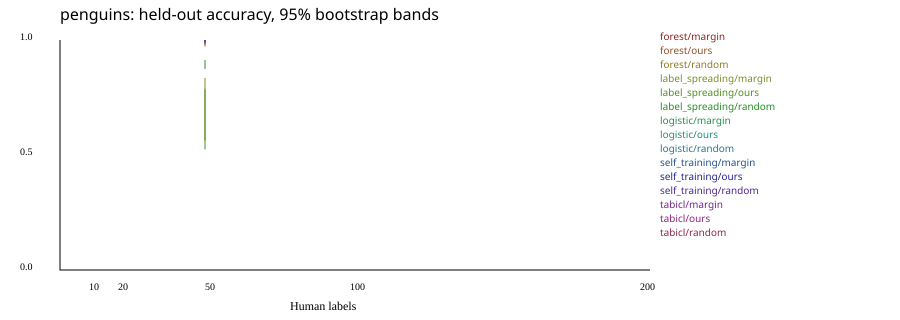

# Benchmark measurements

Generated from [bench.json](bench.json).

Accuracy is among answered rows. Coverage is reported separately. Bootstrap intervals resample seeds with seed 7.

## Active

Script: `scripts/bench_active.py`. Revision: `b246830ff6fd88edbcc4dfe9483393e91f0a5a79`. Machine: Darwin arm64 Python 3.13.16. Wall seconds: 0.218939.

Settings: budgets=50; datasets=penguins; device=auto; learners=tabicl, forest, logistic, label_spreading, self_training; numpy=2.5.4; oracle_noise=0.000000; scikit_learn=1.9.1; seeds=7, 8; smoke=True; source_sha256=9f5e6a14c835ab71f8825db7fd5a8842e85021e94b354753d757c8f4bfe0d172.

| Measurement | Value |
| --- | --- |
| accuracy | hi=1.000000; lo=0.990291; mean=0.995146 |
| answered | hi=103.000000; lo=103.000000; mean=103.000000 |
| balanced_accuracy | hi=1.000000; lo=0.992063; mean=0.996032 |
| budget | 50 |
| dataset | penguins |
| learner | forest |
| noise | 0.000000 |
| seeds | 2 |
| strategy | margin |
| total | hi=103.000000; lo=103.000000; mean=103.000000 |

| Measurement | Value |
| --- | --- |
| accuracy | hi=1.000000; lo=0.990291; mean=0.995146 |
| answered | hi=103.000000; lo=103.000000; mean=103.000000 |
| balanced_accuracy | hi=1.000000; lo=0.992063; mean=0.996032 |
| budget | 50 |
| dataset | penguins |
| learner | forest |
| noise | 0.000000 |
| seeds | 2 |
| strategy | ours |
| total | hi=103.000000; lo=103.000000; mean=103.000000 |

| Measurement | Value |
| --- | --- |
| accuracy | hi=0.990291; lo=0.970874; mean=0.980583 |
| answered | hi=103.000000; lo=103.000000; mean=103.000000 |
| balanced_accuracy | hi=0.992063; lo=0.975610; mean=0.983837 |
| budget | 50 |
| dataset | penguins |
| learner | forest |
| noise | 0.000000 |
| seeds | 2 |
| strategy | random |
| total | hi=103.000000; lo=103.000000; mean=103.000000 |

| Measurement | Value |
| --- | --- |
| accuracy | hi=0.834951; lo=0.563107; mean=0.699029 |
| answered | hi=103.000000; lo=103.000000; mean=103.000000 |
| balanced_accuracy | hi=0.739409; lo=0.556391; mean=0.647900 |
| budget | 50 |
| dataset | penguins |
| learner | label_spreading |
| noise | 0.000000 |
| seeds | 2 |
| strategy | margin |
| total | hi=103.000000; lo=103.000000; mean=103.000000 |

| Measurement | Value |
| --- | --- |
| accuracy | hi=0.786408; lo=0.524272; mean=0.655340 |
| answered | hi=103.000000; lo=103.000000; mean=103.000000 |
| balanced_accuracy | hi=0.701406; lo=0.515038; mean=0.608222 |
| budget | 50 |
| dataset | penguins |
| learner | label_spreading |
| noise | 0.000000 |
| seeds | 2 |
| strategy | ours |
| total | hi=103.000000; lo=103.000000; mean=103.000000 |

| Measurement | Value |
| --- | --- |
| accuracy | hi=0.912621; lo=0.873786; mean=0.893204 |
| answered | hi=103.000000; lo=103.000000; mean=103.000000 |
| balanced_accuracy | hi=0.929476; lo=0.896825; mean=0.913151 |
| budget | 50 |
| dataset | penguins |
| learner | label_spreading |
| noise | 0.000000 |
| seeds | 2 |
| strategy | random |
| total | hi=103.000000; lo=103.000000; mean=103.000000 |

| Measurement | Value |
| --- | --- |
| accuracy | hi=1.000000; lo=0.990291; mean=0.995146 |
| answered | hi=103.000000; lo=103.000000; mean=103.000000 |
| balanced_accuracy | hi=1.000000; lo=0.992063; mean=0.996032 |
| budget | 50 |
| dataset | penguins |
| learner | logistic |
| noise | 0.000000 |
| seeds | 2 |
| strategy | margin |
| total | hi=103.000000; lo=103.000000; mean=103.000000 |

| Measurement | Value |
| --- | --- |
| accuracy | hi=1.000000; lo=0.990291; mean=0.995146 |
| answered | hi=103.000000; lo=103.000000; mean=103.000000 |
| balanced_accuracy | hi=1.000000; lo=0.992063; mean=0.996032 |
| budget | 50 |
| dataset | penguins |
| learner | logistic |
| noise | 0.000000 |
| seeds | 2 |
| strategy | ours |
| total | hi=103.000000; lo=103.000000; mean=103.000000 |

| Measurement | Value |
| --- | --- |
| accuracy | hi=1.000000; lo=0.990291; mean=0.995146 |
| answered | hi=103.000000; lo=103.000000; mean=103.000000 |
| balanced_accuracy | hi=1.000000; lo=0.992063; mean=0.996032 |
| budget | 50 |
| dataset | penguins |
| learner | logistic |
| noise | 0.000000 |
| seeds | 2 |
| strategy | random |
| total | hi=103.000000; lo=103.000000; mean=103.000000 |

| Measurement | Value |
| --- | --- |
| accuracy | hi=0.990291; lo=0.990291; mean=0.990291 |
| answered | hi=103.000000; lo=103.000000; mean=103.000000 |
| balanced_accuracy | hi=0.992063; lo=0.991870; mean=0.991967 |
| budget | 50 |
| dataset | penguins |
| learner | self_training |
| noise | 0.000000 |
| seeds | 2 |
| strategy | margin |
| total | hi=103.000000; lo=103.000000; mean=103.000000 |

| Measurement | Value |
| --- | --- |
| accuracy | hi=0.990291; lo=0.990291; mean=0.990291 |
| answered | hi=103.000000; lo=103.000000; mean=103.000000 |
| balanced_accuracy | hi=0.992063; lo=0.991870; mean=0.991967 |
| budget | 50 |
| dataset | penguins |
| learner | self_training |
| noise | 0.000000 |
| seeds | 2 |
| strategy | ours |
| total | hi=103.000000; lo=103.000000; mean=103.000000 |

| Measurement | Value |
| --- | --- |
| accuracy | hi=0.990291; lo=0.980583; mean=0.985437 |
| answered | hi=103.000000; lo=103.000000; mean=103.000000 |
| balanced_accuracy | hi=0.992063; lo=0.983740; mean=0.987902 |
| budget | 50 |
| dataset | penguins |
| learner | self_training |
| noise | 0.000000 |
| seeds | 2 |
| strategy | random |
| total | hi=103.000000; lo=103.000000; mean=103.000000 |

| Measurement | Value |
| --- | --- |
| accuracy | hi=1.000000; lo=0.990291; mean=0.995146 |
| answered | hi=103.000000; lo=103.000000; mean=103.000000 |
| balanced_accuracy | hi=1.000000; lo=0.992063; mean=0.996032 |
| budget | 50 |
| dataset | penguins |
| ece_10_bins | hi=0.009960; lo=0.004272; mean=0.007116 |
| learner | tabicl |
| noise | 0.000000 |
| seeds | 2 |
| strategy | margin |
| total | hi=103.000000; lo=103.000000; mean=103.000000 |

| Measurement | Value |
| --- | --- |
| accuracy | hi=1.000000; lo=0.990291; mean=0.995146 |
| answered | hi=103.000000; lo=103.000000; mean=103.000000 |
| balanced_accuracy | hi=1.000000; lo=0.992063; mean=0.996032 |
| budget | 50 |
| dataset | penguins |
| ece_10_bins | hi=0.008446; lo=0.007577; mean=0.008012 |
| learner | tabicl |
| noise | 0.000000 |
| seeds | 2 |
| strategy | ours |
| total | hi=103.000000; lo=103.000000; mean=103.000000 |

| Measurement | Value |
| --- | --- |
| accuracy | hi=0.990291; lo=0.990291; mean=0.990291 |
| answered | hi=103.000000; lo=103.000000; mean=103.000000 |
| balanced_accuracy | hi=0.992063; lo=0.991870; mean=0.991967 |
| budget | 50 |
| dataset | penguins |
| ece_10_bins | hi=0.018363; lo=0.012447; mean=0.015405 |
| learner | tabicl |
| noise | 0.000000 |
| seeds | 2 |
| strategy | random |
| total | hi=103.000000; lo=103.000000; mean=103.000000 |

## Active Noise

Script: `scripts/bench_active.py`. Revision: `b246830ff6fd88edbcc4dfe9483393e91f0a5a79`. Machine: Darwin arm64 Python 3.13.16. Wall seconds: 0.062820.

Settings: budgets=50; datasets=penguins; device=auto; learners=tabicl, tree; numpy=2.5.4; oracle_noise=0.100000; scikit_learn=1.9.1; seeds=7, 8; smoke=True; source_sha256=9f5e6a14c835ab71f8825db7fd5a8842e85021e94b354753d757c8f4bfe0d172.

| Measurement | Value |
| --- | --- |
| accuracy | hi=1.000000; lo=0.990291; mean=0.995146 |
| answered | hi=103.000000; lo=103.000000; mean=103.000000 |
| balanced_accuracy | hi=1.000000; lo=0.992063; mean=0.996032 |
| budget | 50 |
| dataset | penguins |
| ece_10_bins | hi=0.055742; lo=0.051920; mean=0.053831 |
| learner | tabicl |
| noise | 0.100000 |
| seeds | 2 |
| strategy | ours |
| total | hi=103.000000; lo=103.000000; mean=103.000000 |

| Measurement | Value |
| --- | --- |
| accuracy | hi=0.990291; lo=0.990291; mean=0.990291 |
| answered | hi=103.000000; lo=103.000000; mean=103.000000 |
| balanced_accuracy | hi=0.992063; lo=0.982456; mean=0.987260 |
| budget | 50 |
| dataset | penguins |
| ece_10_bins | hi=0.128650; lo=0.071902; mean=0.100276 |
| learner | tabicl |
| noise | 0.100000 |
| seeds | 2 |
| strategy | random |
| total | hi=103.000000; lo=103.000000; mean=103.000000 |

| Measurement | Value |
| --- | --- |
| accuracy | hi=0.883495; lo=0.864078; mean=0.873786 |
| answered | hi=103.000000; lo=103.000000; mean=103.000000 |
| balanced_accuracy | hi=0.846334; lo=0.783208; mean=0.814771 |
| budget | 50 |
| dataset | penguins |
| learner | tree |
| noise | 0.100000 |
| seeds | 2 |
| strategy | ours |
| total | hi=103.000000; lo=103.000000; mean=103.000000 |

| Measurement | Value |
| --- | --- |
| accuracy | hi=0.873786; lo=0.873786; mean=0.873786 |
| answered | hi=103.000000; lo=103.000000; mean=103.000000 |
| balanced_accuracy | hi=0.896825; lo=0.896578; mean=0.896702 |
| budget | 50 |
| dataset | penguins |
| learner | tree |
| noise | 0.100000 |
| seeds | 2 |
| strategy | random |
| total | hi=103.000000; lo=103.000000; mean=103.000000 |

## Cold Start

```json
{
  "browser": {
    "git_sha": "b1c94232ca8c71d813862204ef95d65928efc39b",
    "machine": "Darwin arm64 Python 3.13.16",
    "results": [
      {
        "bytes": 43047823,
        "first_proposals_seconds": 22.413567875000002,
        "table_seconds": 1.1319136660000004,
        "visit": "cold"
      },
      {
        "bytes": 0,
        "first_proposals_seconds": 14.081790749999996,
        "table_seconds": 0.2017998340000013,
        "visit": "warm"
      }
    ],
    "script": "scripts/cold_start.py",
    "settings": {
      "device": "auto",
      "numpy": "2.5.4",
      "scikit_learn": "1.9.1",
      "source_sha256": "4d8bb3ee0277b2a3dd26db216e5065a8ae7c7cf472b2d02b8790314fc0b2d129",
      "teacher": "lite model",
      "url": "http://127.0.0.1:4174/"
    },
    "wall_seconds": 70.23163066600682
  }
}
```

## Distill

Script: `scripts/bench_distill.py`. Revision: `b246830ff6fd88edbcc4dfe9483393e91f0a5a79`. Machine: Darwin arm64 Python 3.13.16. Wall seconds: 0.048176.

Settings: budgets=50; datasets=penguins; device=auto; numpy=2.5.4; oracle_noise=0.000000; scikit_learn=1.9.1; seeds=7, 8; smoke=True; source_sha256=9f5e6a14c835ab71f8825db7fd5a8842e85021e94b354753d757c8f4bfe0d172.

Pre-registered result: datasets_passing=; met=False; status=incomplete.

An incomplete matrix is provisional and cannot establish the final teacher-value verdict.

| Measurement | Value |
| --- | --- |
| al_tree | accuracy=hi=0.951456; lo=0.883495; mean=0.917476; coverage=hi=1.000000; lo=1.000000; mean=1.000000 |
| al_tree_mcnemar_share | no_difference=0.500000; other_better=0.000000; rule_better=0.500000 |
| budget | 50 |
| dataset | penguins |
| random_tree | accuracy=hi=0.912621; lo=0.873786; mean=0.893204; coverage=hi=1.000000; lo=1.000000; mean=1.000000 |
| random_tree_mcnemar_share | no_difference=0.500000; other_better=0.000000; rule_better=0.500000 |
| rule | accuracy=hi=0.979798; lo=0.969697; mean=0.974747; coverage=hi=0.961165; lo=0.961165; mean=0.961165 |
| same_settings | accuracy=hi=0.990291; lo=0.961165; mean=0.975728; coverage=hi=1.000000; lo=1.000000; mean=1.000000 |
| same_settings_mcnemar_share | no_difference=1.000000; other_better=0.000000; rule_better=0.000000 |
| seeds | 2 |
| teacher | accuracy=hi=1.000000; lo=0.990291; mean=0.995146; coverage=hi=1.000000; lo=1.000000; mean=1.000000 |
| tuned | accuracy=hi=0.980583; lo=0.941748; mean=0.961165; coverage=hi=1.000000; lo=1.000000; mean=1.000000 |
| tuned_mcnemar_share | no_difference=1.000000; other_better=0.000000; rule_better=0.000000 |

## Leaks

Script: `scripts/bench_leaks.py`. Revision: `b246830ff6fd88edbcc4dfe9483393e91f0a5a79`. Machine: Darwin arm64 Python 3.13.16. Wall seconds: 0.044565.

Settings: budgets=50; datasets=penguins; device=auto; flip_rates=0.000000, 0.050000, 0.100000, 0.200000, 0.400000; numpy=2.5.4; scikit_learn=1.9.1; seeds=7, 8; smoke=True; source_sha256=9f5e6a14c835ab71f8825db7fd5a8842e85021e94b354753d757c8f4bfe0d172.

| Measurement | Value |
| --- | --- |
| budget | 50 |
| clean_column_false_positive_rate | hi=0.000000; lo=0.000000; mean=0.000000 |
| dataset | penguins |
| detection_rate | hi=0.000000; lo=0.000000; mean=0.000000 |
| flip_rate | 0.000000 |
| seeds | 2 |

| Measurement | Value |
| --- | --- |
| budget | 50 |
| clean_column_false_positive_rate | hi=0.000000; lo=0.000000; mean=0.000000 |
| dataset | penguins |
| detection_rate | hi=0.000000; lo=0.000000; mean=0.000000 |
| flip_rate | 0.050000 |
| seeds | 2 |

| Measurement | Value |
| --- | --- |
| budget | 50 |
| clean_column_false_positive_rate | hi=0.000000; lo=0.000000; mean=0.000000 |
| dataset | penguins |
| detection_rate | hi=0.000000; lo=0.000000; mean=0.000000 |
| flip_rate | 0.100000 |
| seeds | 2 |

| Measurement | Value |
| --- | --- |
| budget | 50 |
| clean_column_false_positive_rate | hi=0.000000; lo=0.000000; mean=0.000000 |
| dataset | penguins |
| detection_rate | hi=0.000000; lo=0.000000; mean=0.000000 |
| flip_rate | 0.200000 |
| seeds | 2 |

| Measurement | Value |
| --- | --- |
| budget | 50 |
| clean_column_false_positive_rate | hi=0.000000; lo=0.000000; mean=0.000000 |
| dataset | penguins |
| detection_rate | hi=0.000000; lo=0.000000; mean=0.000000 |
| flip_rate | 0.400000 |
| seeds | 2 |

## Llm

Script: `scripts/bench_llm.py`. Revision: `b246830ff6fd88edbcc4dfe9483393e91f0a5a79`. Machine: Darwin arm64 Python 3.13.16. Wall seconds: 0.103754.

Settings: budgets=50; datasets=penguins; device=auto; eval_rows=10; model_digest=0ce5ff81f9ffdf89dd8192ca7b5d34cefd8996a875b3aaaaafaf5c4813569eba; numpy=2.5.4; scikit_learn=1.9.1; seeds=7, 8; smoke=True; source_sha256=9f5e6a14c835ab71f8825db7fd5a8842e85021e94b354753d757c8f4bfe0d172.

| Measurement | Value |
| --- | --- |
| budget | 50 |
| caveat | may be memorised: famous public dataset |
| dataset | penguins |
| llm_accuracy | hi=1.000000; lo=0.800000; mean=0.900000 |
| llm_balanced_accuracy | hi=1.000000; lo=0.822222; mean=0.911111 |
| median_seconds_per_row | hi=0.503839; lo=0.417120; mean=0.460480 |
| run_agreement | hi=1.000000; lo=1.000000; mean=1.000000 |
| seeds | 2 |
| teacher_accuracy | hi=1.000000; lo=0.900000; mean=0.950000 |
| teacher_balanced_accuracy | hi=1.000000; lo=0.933333; mean=0.966667 |

## Teacher

```json
{
  "penguins_6_labels": {
    "accuracy": 0.8905325443786982
  }
}
```

## Label efficiency


